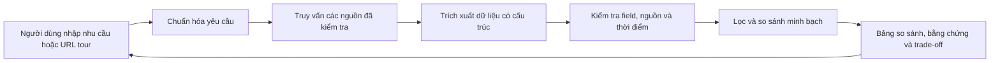

# Tour Decision Support

Hệ thống hỗ trợ người Việt so sánh tour và nhà cung cấp dựa trên dữ liệu có nguồn gốc, độ mới và trade-off rõ ràng. Người dùng tự quyết định; sản phẩm không tự lập lịch trình hay đặt tour.



Đây là kiến trúc mục tiêu; repo hiện chưa có implementation, các tài liệu dưới đây là bản review.

- [Proposal và phân tích bài toán](docs/idea.md)
- [Kiến trúc hệ thống](docs/system-architecture.md)
- [Hợp đồng dữ liệu và API](docs/data-contract.md)
- [Phân công và quy ước Git](docs/team-workflow.md)
- [Wireframe](docs/wireframes.md)

## Phát triển

```powershell
uv sync
uv run ruff check .
```

## Chạy tối thiểu module ingest

```powershell
uv run python -m ingest.run --source <source>
```

Chạy lẻ từng bước khi cần:

```powershell
uv run python -m ingest.survey --source <source>
uv run python -m ingest --discover --profile <source> --limit 5
uv run python -m ingest --batch --profile <source>
uv run python -m ingest.audit --profile <source>
uv run python -m ingest --migrate
uv run python -m ingest --publish --profile <source>
```

`<source>` là tên trong cột source của `configs/sources-mvp.csv`.

Chi tiết hợp đồng profile/discovery: `src/ingest/README.md`.
