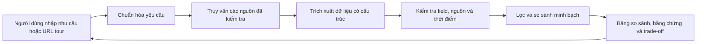

# Tour Decision Support

Hệ thống hỗ trợ người Việt so sánh tour và nhà cung cấp dựa trên dữ liệu có nguồn gốc, độ mới và trade-off rõ ràng. Người dùng tự quyết định; sản phẩm không tự lập lịch trình hay đặt tour.

Để mở website, xem [hướng dẫn frontend từng bước](src/frontend/README.md): cài Node.js LTS/npm và pnpm, chạy hai terminal frontend/backend rồi mở port **5173**. Port **8000** là API. [Preview Vercel nối backend riêng](docs/frontend-vercel-preview.md) là hướng chia sẻ website qua link; chưa có link deploy được xác nhận.



Backend có `/v1` và `/v2`: hiểu nhu cầu qua NVIDIA NIM, proposal đa field chờ xác nhận, form/URL/hybrid, so sánh/ranking/evidence, durable jobs/events và admin/contact. Xem [runtime v2](docs/backend-v2-runtime.md) và [hướng dẫn nối frontend](examples/backend-v2.md). Package `tourcrawl` chạy độc lập; chưa có adapter nối output crawler vào backend. Frontend React gọi API v2; API mặc định dùng dữ liệu mô phỏng và cần cấu hình provider thật để tìm tour.

- [Proposal và phân tích bài toán](docs/idea.md)
- [Kiến trúc hệ thống](docs/system-architecture.md)
- [Wireframe](docs/wireframes.md)
- [Kế hoạch backend](docs/backend-plan.md)
- [Contract dữ liệu backend — bản nháp](docs/backend-contracts.md)
- [Module hiểu yêu cầu — bản nháp](src/requirements/README.md)
- [Contract crawler và mẫu JSON — bản nháp](docs/crawler-contract.md)
- [Contract API cho frontend — bản nháp](docs/api-contract.md)
- [Bộ tình huống đánh giá tiếng Việt](docs/requirements-evaluation.md)
- [Phân công/quy ước Git](docs/team-workflow.md), [registry nguồn](docs/provider-registry.md)

## Chạy backend

Python >= 3.12 và uv. Chạy từ thư mục repo:

```powershell
uv sync
uv run tour-backend serve
```

Trang chào backend: `http://127.0.0.1:8000/`; tài liệu tương tác: `http://127.0.0.1:8000/docs`. Sau khi sửa code, dừng server bằng Ctrl+C rồi chạy lại để nạp thay đổi.
NIM đọc `NVIDIA_NIM_API` và `NVIDIA_NIM_MODEL` từ `.env` hiện có. Ngân sách chưa nói phạm vi mặc định là **giá tour**, có provenance `system_default`; currency/basis chưa rõ vẫn được hỏi lại.

Đọc kho tour thật bằng `DATA_PROVIDER=supabase` và `SUPABASE_TOUR_DB_URL`. Dùng API **v2**; [khởi động và test Supabase từng bước](examples/backend-supabase-v2.md). `uv run tour-backend probe-supabase` kiểm tra kết nối/counts bằng transaction chỉ đọc. SQLite vẫn lưu phiên, nhu cầu và kết quả; Supabase lưu catalog do crawler cập nhật.

Semantic extraction v2 (`requirements-v2.2`) giữ ghép đoàn, tuyến đường, các ưu tiên định tính và khoảng lịch âm; hỏi năm/ý nghĩa khoảng trước khi quy đổi. [Test ca Tết từng bước](examples/backend-semantic-v2.md), [contract frontend/crawler](docs/requirements-semantics.md), [kết quả kiểm chứng](docs/requirements-evaluation.md). Cần tạo request mới sau khi restart để thử parser mới; lịch sử không tự được trích xuất lại.

Pipeline v2 lọc structured hard conditions trước khi cắt pool, kiểm tra toàn bộ yêu cầu trên từng offer; LLM đánh giá ưu tiên ngữ nghĩa bằng trích dẫn, backend tính ranking với coverage/khoảng điểm. Hard/soft độc lập kiểu dữ liệu. [Hướng dẫn test và đọc output](examples/backend-retrieval-semantic-v2.md), [kết quả và phần dữ liệu còn thiếu](docs/backend-retrieval-assessment-results.md).

Form/text v2 dùng chung năm core fields trước confirm/search; draft được phép thiếu, ngân sách form là hard cap giá tour/người lớn. Xem [flow mới và typed answers](examples/backend-personalized-v2.md), [nghiệm thu](docs/backend-personalized-verification.md). `uv run tour-backend audit-supabase` đọc catalog và xuất báo cáo chất lượng có giới hạn; không cập nhật rows hoặc tạo dữ liệu tour.

Sau comparison, v2 có phân tích nếu bỏ/nới điều kiện: đọc snapshot rộng, giữ hard/soft và AND/OR, đo lựa chọn/thứ hạng thay đổi, công khai bằng chứng và tỷ lệ có mẫu số. Kịch bản tạo proposal để review; chưa tự đổi nhu cầu. [Hướng dẫn test](examples/backend-what-if-v2.md), [policy](docs/what-if-analysis.md), [kết quả kiểm chứng](docs/backend-what-if-verification.md).

- [Hướng dẫn frontend, payload và cấu hình](examples/README.md)
- [Runtime, lệnh kiểm tra và giới hạn](docs/backend-runtime.md)
- [JSON Schema đã xuất cho team](contracts/README.md)

## Frontend

Website React + TypeScript + Vite ở port **5173**, API backend ở port **8000**. Xem [hướng dẫn chạy từng bước, hai terminal và xử lý lỗi](src/frontend/README.md). Chạy từ repo root:

```powershell
# Terminal 1: giữ backend chạy
uv sync
uv run tour-backend serve
```

```powershell
# Terminal 2: giữ frontend chạy
pnpm.cmd --dir src/frontend install --frozen-lockfile
pnpm.cmd --dir src/frontend dev
```

Mở **http://127.0.0.1:5173** → Tìm tour → Tiếp tục với phiên ẩn danh. Cần Node.js/pnpm và Python/uv; chạy mặc định không cần nhập API token vào frontend. Backend mặc định dùng dữ liệu mô phỏng, frontend chặn tìm kiếm nguồn này: để tìm tour thật, cấu hình provider theo [hướng dẫn Supabase](examples/backend-supabase-v2.md); NIM cho chat/phân tích cấu hình ở backend.

Có chọn nhiều tháng/năm, khoảng ngân sách, thời lượng, form/chat/proposal, lịch sử tài khoản và draft cục bộ, comparison/evidence/activity, Việt/Anh và sáng/tối. Supabase Auth đã nối; xem [giới hạn tích hợp](src/frontend/BACKEND-GAPS.md) và [contract auth adapter](src/frontend/app/AUTH-ADAPTER.md).

Profile Hub lưu sở thích, tour đang cân nhắc, ghi chú/bộ sưu tập và mẫu nhu cầu trên Supabase Auth. Dùng mẫu/sở thích tạo phiên mới để review; lịch/giá tour lưu luôn là dữ liệu lịch sử. Cần chạy migration riêng theo [hướng dẫn bật Profile Hub](examples/profile-hub-supabase.md); [contract](docs/profile-hub.md) và [kiểm chứng](docs/profile-hub-verification.md).

Preview chung dự kiến dùng **frontend Vercel nối backend riêng** để người xem chỉ mở link. [Cấu hình và phụ thuộc Vercel](docs/frontend-vercel-preview.md) mô tả phần cần chuẩn bị; repo chưa có link deploy được xác nhận.
Frontend React + TypeScript + Vite nằm tại [src/frontend](src/frontend/README.md). Nếu terminal chưa nhận `pnpm` nhưng có Corepack, chạy từ repo root:

```powershell
corepack pnpm --dir src/frontend install --frozen-lockfile
corepack pnpm --dir src/frontend dev
```

Mở `http://127.0.0.1:5173/`; backend local ở port 8000. Nếu dùng lệnh `pnpm` trực tiếp, phải chạy trong `src/frontend`, nơi có package.json/script dev. Có form/chat/proposal, history tài khoản + draft cục bộ, comparison/evidence/activity/what-if, Việt/Anh và sáng/tối. Backend cần provider dữ liệu thật để tìm kiếm; Supabase Auth adapter và lịch sử server đã nối, xem [hướng dẫn đăng nhập/what-if](examples/frontend-account-what-if.md), [giới hạn tích hợp](src/frontend/BACKEND-GAPS.md) và [contract auth adapter](src/frontend/app/AUTH-ADAPTER.md).

- [Prototype frontend](prototypes/frontend-design/README.md)
- [Flow và trạng thái UI](docs/frontend-flows.md)
- [API client v2](src/frontend/api/README.md), [hướng tích hợp API v1](docs/frontend-api-integration.md)
- [Giao thức frontend v2](docs/frontend-protocol-v2.md)
- [Đối chiếu crawler/backend và công việc tích hợp dữ liệu](docs/frontend-crawler-integration.md)
- [module frontend](src/frontend/README.md)

## Kiểm tra backend

Mặc định của code là `DATA_PROVIDER=fixture`: ba tour giả lập tại `tour-demo.invalid`, `origin=synthetic`. Cấu hình `supabase` đọc catalog thật và trả `origin=source`, không fallback sang dữ liệu giả. [Catalog validation](docs/catalog-validation-policy.md) cho phép field qua kiểm tra thuộc domain opt-in được dùng với trạng thái `catalog_validated`; website proof là bổ sung. Giá thiếu qualifiers, field mơ hồ hoặc freshness chưa rõ vẫn `unknown`. Local runtime dùng SQLite và một worker; không chạy nhiều process trên cùng application database.

```powershell
uv run pytest -q
uv run ruff check src tests
uv run tour-backend export-schemas
```

Gọi NIM thật (tách khỏi tests offline): `uv run tour-backend probe-nim`; bộ smoke tiếng Việt: `uv run tour-backend evaluate-nim`. Kết quả smoke không thay bộ gold 50 câu + 15 chuỗi hội thoại đầy đủ.

## Crawler và dữ liệu

[tourcrawl pipeline](src/tourcrawl/pipeline/README.md) chạy CLI độc lập, output CSV/JSON detail; profiles tại `configs/profiles/`. Browser flow cần `uv sync --extra browser` và Chromium của Playwright. Các script khảo sát/profile nằm tại `scripts/`, đọc/ghi artifacts được ignore; không có bộ dữ liệu tour thật đã nghiệm thu trong Git.

HTTP crawler giữ [contract v1](docs/crawler-contract.md); Supabase có [reader/adapter v2](src/data_access/supabase/README.md). Không cần bulk backfill proof: crawler cần làm rõ price qualifiers/cadence và các field mơ hồ; quote bổ sung có chọn lọc. Backend chưa tự đặt TTL hoặc gọi live crawler khi URL vắng trong kho. [Hướng dẫn cấu hình](examples/backend-catalog-validation.md), [nghiệm thu hiện hành](docs/backend-catalog-validation-verification.md); [baseline trước policy mới](docs/supabase-tour-integration-plan.md).
