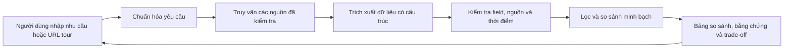

# Tour Decision Support

Hệ thống hỗ trợ người Việt so sánh tour và nhà cung cấp dựa trên dữ liệu có nguồn gốc, độ mới và trade-off rõ ràng. Người dùng tự quyết định; sản phẩm không tự lập lịch trình hay đặt tour.



Đây là kiến trúc mục tiêu; hiện repo mới có crawler khảo sát nguồn, chưa có ứng dụng decision support hoàn chỉnh.

- [Proposal và phân tích bài toán](docs/idea.md)
- [Kiến trúc hệ thống](docs/system-architecture.md)
- [Hợp đồng dữ liệu và API](docs/data-contract.md)
- [Phân công và quy ước Git](docs/team-workflow.md)
- [Wireframe](docs/wireframes.md)
- [Quy ước danh mục nhà cung cấp](docs/provider-registry.md)
- [Danh mục nguồn hiện tại](data/providers.toml)
- [Crawler khảo sát nguồn](src/crawler/README.md)

## Phát triển crawler

```powershell
uv sync
uv run pytest
uv run ruff check .
uv run supplier-crawler inspect <url> --output .local/crawl-reports/report.json
```
