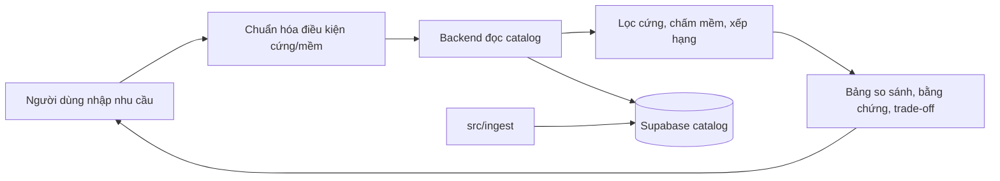

# Tour Decision Support

Hệ thống hỗ trợ người Việt so sánh tour và nhà cung cấp dựa trên dữ liệu có nguồn gốc, độ mới và trade-off rõ ràng. Người dùng tự quyết định; sản phẩm không tự lập lịch trình hay đặt tour.



- [Kiến trúc hệ thống](docs/system-architecture.md)
- [Hợp đồng dữ liệu](docs/data-contract.md) · [Hợp đồng backend](docs/backend-contract.md)
- [Phạm vi MVP](docs/tour-mvp-scope.md) · [Quy ước làm việc](docs/team-workflow.md)
- [Module backend](src/backend/README.md) · [Module frontend](src/frontend/README.md) · [Module ingest](src/ingest/README.md)
- [Deploy preview](docs/frontend-vercel-preview.md)

## Chạy local

Cài phụ thuộc một lần từ repo root:

```powershell
uv sync
pnpm.cmd --dir src/frontend install
```

Đặt `OPENCODE_SERVER_URL` và `OPENCODE_SERVER_PASSWORD` trong `.env`. Sau đó mở ba terminal tại repo root và chạy:

**Terminal 1 — OpenCode**

```powershell
uv run tour-opencode serve
```

Lệnh tự nạp `.env` và lấy cổng từ `OPENCODE_SERVER_URL`.

**Terminal 2 — Backend**

```powershell
uv run tour-backend serve
```

API: <http://127.0.0.1:8000/docs>. Backend tự truyền mật khẩu cho CLI attach.

**Terminal 3 — Frontend**

```powershell
uv run tour-frontend dev
```

Mở <http://127.0.0.1:5173>. Vite proxy API tới backend ở cổng `8000`. Giữ cả ba terminal chạy khi dùng web; dừng từng dịch vụ bằng `Ctrl+C`.

Mặc định local dùng SQLite và catalog fixture. Khi có `SUPABASE_TOUR_DB_URL`, backend dùng cùng URL cho runtime store (đọc/ghi) và catalog Supabase (chỉ đọc catalog); không cần `DATABASE_URL` hay `DATA_PROVIDER`.

## Frontend

React UI nằm tại `src/frontend`. Guest search đã nối với API hiện tại từ session đến comparison snapshot; Auth, account history, proposals, jobs, contact và what-if chưa được port. Tiếp tục phát triển trên `src/backend`, không khôi phục `src/api` cũ.

## Kiểm tra

```powershell
uv run pytest -q
uv run ruff check src tests
pnpm.cmd --dir src/frontend typecheck
pnpm.cmd --dir src/frontend test
pnpm.cmd --dir src/frontend build
```
