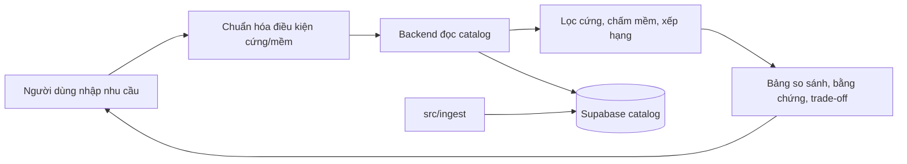

# Tour Decision Support

Hệ thống hỗ trợ người Việt so sánh tour và nhà cung cấp dựa trên dữ liệu có nguồn gốc, độ mới và trade-off rõ ràng. Người dùng tự quyết định; sản phẩm không tự lập lịch trình hay đặt tour.



- [Kiến trúc hệ thống](docs/system-architecture.md)
- [Hợp đồng dữ liệu](docs/data-contract.md) · [Hợp đồng backend](docs/backend-contract.md)
- [Phạm vi MVP](docs/tour-mvp-scope.md) · [Quy ước làm việc](docs/team-workflow.md)
- [Module backend](src/backend/README.md) · [Module frontend](src/frontend/README.md) · [Module ingest](src/ingest/README.md)
- [Deploy preview](docs/frontend-vercel-preview.md)

## Chạy local

Cài phụ thuộc một lần từ repo root:

```powershell
uv sync
pnpm.cmd --dir src/frontend install
```

Local chat dùng Codex CLI `0.162.1` với model `gpt-6-luna`, effort `xhigh`; đăng nhập bằng device-code flow nếu gateway báo mã xác thực. OpenCode CLI và `opencode.model` vẫn dành cho survey/ingest và chat legacy trên Render. Sau đó chạy một lệnh duy nhất tại repo root (backend tự reload khi sửa code, web tự HMR):

```powershell
corepack pnpm --dir src/frontend dev:all
```

`dev:all` chạy hai module Python bằng `uv run --no-sync` để tránh các tiến trình đồng bộ cùng `.venv` song song; chạy `uv sync` sau khi thay đổi dependencies Python. Ba service (backend `8000` + Codex gateway `4099` + web `5173`) chạy chung một terminal với log gắn màu riêng; `Ctrl+C` một lần dừng cả ba. `dev:all` tự dọn tiến trình cũ còn giữ 3 port này trước khi khởi động (`scripts/clean-dev.mjs`); nếu kill terminal bằng Force, worker reloader mồ côi có thể giữ port với code cũ — chạy lại `dev:all` (kích hoạt dọn dẹp) rồi kiểm tra `/health` không còn trả lời trước khi coi như đã tắt hẳn. Survey tiếp tục gọi OpenCode CLI riêng. Trên Render, backend giữ OpenCode tới khi xác nhận điều kiện hosted của OpenAI; dịch vụ Codex free cần device-code login lại sau spin-down/redeploy và không resume thread cũ.

Mặc định local dùng SQLite cho runtime store. Catalog luôn là Supabase chỉ-đọc qua `SUPABASE_TOUR_DB_URL`; thiếu URL thì backend báo `CATALOG_NOT_CONFIGURED`, không có fallback offline. Tests dùng rows inline trong `tests/sample_rows.py`, không đọc file fixture.

## Frontend

React UI nằm tại `src/frontend`. Guest search đã nối với API hiện tại từ session đến comparison snapshot; Auth, account history, proposals, jobs, contact và what-if chưa được port. Tiếp tục phát triển trên `src/backend`, không khôi phục `src/api` cũ.

## Kiểm tra

```powershell
uv run pytest -q
uv run ruff check src tests
pnpm.cmd --dir src/frontend typecheck
pnpm.cmd --dir src/frontend test
pnpm.cmd --dir src/frontend build
```
