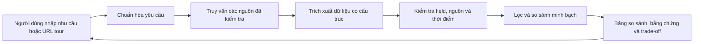

# Tour Decision Support

Hệ thống hỗ trợ người Việt so sánh tour và nhà cung cấp dựa trên dữ liệu có nguồn gốc, độ mới và trade-off rõ ràng. Người dùng tự quyết định; sản phẩm không tự lập lịch trình hay đặt tour.



Trạng thái sau merge (08/10/2026): tầng ingest đã implement (`src/ingest`, 3 profile audit, Supabase tour) và backend v1/v2 đã implement (FastAPI, requirements/NIM, compare, đọc Supabase catalog); UI prototype đang review. Tích hợp crawler→backend qua Supabase reader/adapter vẫn đang hoàn thiện.

- [Proposal và phân tích bài toán](docs/idea.md)
- [Kiến trúc hệ thống](docs/system-architecture.md)
- [Wireframe](docs/wireframes.md)
- [Contract dữ liệu backend — bản nháp](src/domain/backend-contracts.md)
- [Module hiểu yêu cầu — bản nháp](src/requirements/README.md)
- [Contract crawler và mẫu JSON — bản nháp](src/data_access/crawler-contract.md)
- [Contract API cho frontend — bản nháp](src/api/api-contract.md)
- [Phân công/quy ước Git](docs/team-workflow.md), [registry nguồn](docs/provider-registry.md)
- [Phạm vi MVP tour](docs/tour-mvp-scope.md), [đề bài TMA](docs/archive/TMA.md)

## Chạy backend

Python >= 3.12 và uv. Chạy từ thư mục repo:

```powershell
uv sync
uv run tour-backend serve
```

## Chạy tối thiểu module ingest

```powershell
uv run python -m ingest.run --source <source>
```

Bỏ `--source`/`--profile` nghĩa là chạy tất cả (`sources-mvp.csv` / `configs/profiles/`); URL lẻ không kèm profile thì suy ra từ origin.

Chạy lẻ từng bước khi cần:

```powershell
uv run python -m ingest.survey --source <source>
uv run python -m ingest --discover --profile <source> --limit 5
uv run python -m ingest --batch --profile <source>
uv run python -m ingest --migrate
uv run python -m ingest --publish --profile <source>
```

Audit (`uv run python -m ingest.audit --profile <source>`) không nằm trong chain — chỉ chạy tay khi đổi profile hoặc thêm nguồn mới. `--output`/`--out-dir`/`--batch <csv>`/`--publish <dir>`/audit `--urls`/`--out-dir` đi với đúng một source; chạy all thì dùng đường dẫn mặc định theo từng source.

`<source>` là tên trong cột source của `configs/sources-mvp.csv`.

Chi tiết hợp đồng profile/discovery: `src/ingest/README.md`.
Trang chào backend: `http://127.0.0.1:8000/`; tài liệu tương tác: `http://127.0.0.1:8000/docs`. Sau khi sửa code, dừng server bằng Ctrl+C rồi chạy lại để nạp thay đổi.
NIM đọc `NVIDIA_NIM_API` và `NVIDIA_NIM_MODEL` từ `.env` hiện có. Ngân sách chưa nói phạm vi mặc định là **giá tour**, có provenance `system_default`; currency/basis chưa rõ vẫn được hỏi lại.

Đọc kho tour thật bằng `DATA_PROVIDER=supabase` và `SUPABASE_TOUR_DB_URL`. Dùng API **v2**; [khởi động và test Supabase từng bước](examples/backend-supabase-v2.md). `uv run tour-backend probe-supabase` kiểm tra kết nối/counts bằng transaction chỉ đọc. SQLite vẫn lưu phiên, nhu cầu và kết quả; Supabase lưu catalog do crawler cập nhật.

Semantic extraction v2 (`requirements-v2.2`) giữ ghép đoàn, tuyến đường, các ưu tiên định tính và khoảng lịch âm; hỏi năm/ý nghĩa khoảng trước khi quy đổi. [Test ca Tết từng bước](examples/backend-semantic-v2.md), [contract frontend/crawler](src/requirements/requirements-semantics.md), [kết quả kiểm chứng](docs/archive/requirements-evaluation.md). Cần tạo request mới sau khi restart để thử parser mới; lịch sử không tự được trích xuất lại.

Pipeline v2 lọc structured hard conditions trước khi cắt pool, kiểm tra toàn bộ yêu cầu trên từng offer; LLM đánh giá ưu tiên ngữ nghĩa bằng trích dẫn, backend tính ranking với coverage/khoảng điểm. Hard/soft độc lập kiểu dữ liệu. [Hướng dẫn test và đọc output](examples/backend-retrieval-semantic-v2.md), [kết quả và phần dữ liệu còn thiếu](docs/archive/backend-retrieval-assessment-results.md).

Form/text v2 dùng chung năm core fields trước confirm/search; draft được phép thiếu, ngân sách form là hard cap giá tour/người lớn. Xem [flow mới và typed answers](examples/backend-personalized-v2.md), [nghiệm thu](docs/archive/backend-personalized-verification.md). `uv run tour-backend audit-supabase` đọc catalog và xuất báo cáo chất lượng có giới hạn; không cập nhật rows hoặc tạo dữ liệu tour.

Sau comparison, v2 có phân tích nếu bỏ/nới điều kiện: đọc snapshot rộng, giữ hard/soft và AND/OR, đo lựa chọn/thứ hạng thay đổi, công khai bằng chứng và tỷ lệ có mẫu số. Kịch bản tạo proposal để review; chưa tự đổi nhu cầu. [Hướng dẫn test](examples/backend-what-if-v2.md), [policy](src/api/what-if-analysis.md), [kết quả kiểm chứng](docs/archive/backend-what-if-verification.md).

- [Hướng dẫn frontend, payload và cấu hình](examples/README.md)
- [Runtime, lệnh kiểm tra và giới hạn](src/api/backend-runtime.md)
- [JSON Schema đã xuất cho team](contracts/README.md)

## Kiểm tra backend

Mặc định của code là `DATA_PROVIDER=fixture`: ba tour giả lập tại `tour-demo.invalid`, `origin=synthetic`. Cấu hình `supabase` đọc catalog thật và trả `origin=source`, không fallback sang dữ liệu giả. [Catalog validation](src/data_access/supabase/catalog-validation-policy.md) cho phép field qua kiểm tra thuộc domain opt-in được dùng với trạng thái `catalog_validated`; website proof là bổ sung. Giá thiếu qualifiers, field mơ hồ hoặc freshness chưa rõ vẫn `unknown`. Local runtime dùng SQLite và một worker; không chạy nhiều process trên cùng application database.

```powershell
uv run pytest -q
uv run ruff check src tests
uv run tour-backend export-schemas
```

Gọi NIM thật (tách khỏi tests offline): `uv run tour-backend probe-nim`; bộ smoke tiếng Việt: `uv run tour-backend evaluate-nim`. Kết quả smoke không thay bộ gold 50 câu + 15 chuỗi hội thoại đầy đủ.

## Crawler và dữ liệu

Crawler chuẩn duy nhất là `src/ingest` (3 profile audit, Supabase ~1200 tour live): survey agent vẽ map → discover (sitemap/search_pages) → batch → audit tay → publish. Chạy `uv run python -m ingest.run` (all sources) hoặc lẻ từng bước ở mục ingest phía trên; chi tiết ở `src/ingest/README.md`. Browser flow cần `uv sync --extra browser`.

HTTP crawler giữ [contract v1](src/data_access/crawler-contract.md); Supabase có [reader/adapter v2](src/data_access/supabase/README.md). Không cần bulk backfill proof: crawler cần làm rõ price qualifiers/cadence và các field mơ hồ; quote bổ sung có chọn lọc. Backend chưa tự đặt TTL hoặc gọi live crawler khi URL vắng trong kho. [Hướng dẫn cấu hình](examples/backend-catalog-validation.md), [nghiệm thu hiện hành](docs/archive/backend-catalog-validation-verification.md); [baseline trước policy mới](src/data_access/supabase-tour-integration-plan.md).
