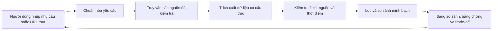

# Tour Decision Support

Hệ thống hỗ trợ người Việt so sánh tour và nhà cung cấp dựa trên dữ liệu có nguồn gốc, độ mới và trade-off rõ ràng. Người dùng tự quyết định; sản phẩm không tự lập lịch trình hay đặt tour.



Idea, kiến trúc và wireframe đã chốt. Backend v1 có API, hiểu nhu cầu qua NVIDIA NIM, bộ lọc/so sánh, revision và worker. Package `tourcrawl` và các script khảo sát nguồn đã được đưa về nhánh này; chưa có adapter nối output crawler vào backend. Hai luồng API mặc định vẫn dùng dữ liệu mô phỏng; frontend đang PLANNING.

- [Proposal và phân tích bài toán](docs/idea.md)
- [Kiến trúc hệ thống](docs/system-architecture.md)
- [Wireframe](docs/wireframes.md)
- [Kế hoạch backend để thảo luận](docs/backend-plan.md)
- [Contract dữ liệu backend — bản nháp](docs/backend-contracts.md)
- [Module hiểu yêu cầu — bản nháp](src/requirements/README.md)
- [Contract crawler và mẫu JSON — bản nháp](docs/crawler-contract.md)
- [Contract API cho frontend — bản nháp](docs/api-contract.md)
- [Bộ tình huống đánh giá tiếng Việt](docs/requirements-evaluation.md)
- [Phân công/quy ước Git](docs/team-workflow.md), [registry nguồn](docs/provider-registry.md)

## Chạy backend

Python >= 3.12 và uv. Chạy từ thư mục repo:

```powershell
uv sync
uv run tour-backend serve
```

Trang chào backend: `http://127.0.0.1:8000/`; tài liệu tương tác: `http://127.0.0.1:8000/docs`. Sau khi sửa code, dừng server bằng Ctrl+C rồi chạy lại để nạp thay đổi.
NIM đọc `NVIDIA_NIM_API` và `NVIDIA_NIM_MODEL` từ `.env` hiện có. Ngân sách chưa nói phạm vi mặc định là **giá tour**, có provenance `system_default`; currency/basis chưa rõ vẫn được hỏi lại.

- [Hướng dẫn frontend, payload và cấu hình](examples/README.md)
- [Runtime, lệnh kiểm tra và giới hạn](docs/backend-runtime.md)
- [JSON Schema đã xuất cho team](contracts/README.md)

## Planning frontend

Frontend đang PLANNING; chưa production UI hoặc chốt stack. Ngày 06/10/2026 user chốt **Giấy & Mực**, Newsreader + Be Vietnam Pro; flow mới **Giới thiệu → form + xác nhận → Kết quả**, criteria rộng/sửa trực tiếp/chat có diff xác nhận, bảng kiểm chứng + Phân tích AI, log/loading mock và accent/motion. Token/màn chi tiết còn review; G1–G13/D1–D5 giữ phần backend cần chốt.

- [Roadmap 7 phase và todo frontend](docs/frontend-plan.md)
- [Quyết định review nhóm 06/10/2026](docs/frontend-review-2026-10-06.md), [prototype minh họa](prototypes/frontend-design/README.md)
- [Flow và trạng thái UI](docs/frontend-flows.md)
- [Hướng tích hợp API v1 theo code](docs/frontend-api-integration.md)
- [Checklist contract và khoảng thiếu cần trao đổi với BE](docs/frontend-backend-checklist.md)
- [Đối chiếu crawler/backend và công việc tích hợp dữ liệu](docs/frontend-crawler-integration.md)
- [Chuẩn bị skill/thiết kế](docs/frontend-design-preparation.md), [module frontend](src/frontend/README.md)

## Kiểm tra backend

Mặc định `DATA_PROVIDER=fixture`: ba tour giả lập tại `tour-demo.invalid`; mọi kết quả có `origin=synthetic`. Không có dữ liệu tour thật trong repo. Local runtime dùng SQLite và một worker; không chạy nhiều process trên cùng database.

```powershell
uv run pytest -q
uv run ruff check src tests
uv run tour-backend export-schemas
```

Gọi NIM thật (tách khỏi tests offline): `uv run tour-backend probe-nim`; bộ smoke tiếng Việt: `uv run tour-backend evaluate-nim`. Kết quả smoke không thay bộ gold 50 câu + 15 chuỗi hội thoại đầy đủ.

## Crawler và dữ liệu

[tourcrawl pipeline](src/tourcrawl/pipeline/README.md) chạy CLI độc lập, output CSV/JSON detail; profiles tại `configs/profiles/`. Browser flow cần `uv sync --extra browser` và Chromium của Playwright. Các script khảo sát/profile nằm tại `scripts/`, đọc/ghi artifacts được ignore; không có bộ dữ liệu tour thật đã nghiệm thu trong Git.

API runtime dùng [HTTP/domain contract v1](docs/api-contract.md) và [CrawlRequest/CrawlResult](docs/crawler-contract.md). [Data contract cũ](docs/data-contract.md) giữ danh sách field/yêu cầu chưa đáp ứng, không phải API đang chạy. Adapter, registry/TTL, giá/offer/evidence và profile format còn D1–D5 trong [đối chiếu tích hợp](docs/frontend-crawler-integration.md).
