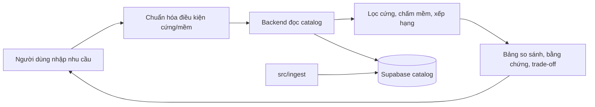

# Tour Decision Support

Hệ thống hỗ trợ người Việt so sánh tour và nhà cung cấp dựa trên dữ liệu có nguồn gốc, độ mới và trade-off rõ ràng. Người dùng tự quyết định; sản phẩm không tự lập lịch trình hay đặt tour.



- [Kiến trúc hệ thống](docs/system-architecture.md)
- [Hợp đồng dữ liệu](docs/data-contract.md) · [Hợp đồng backend](docs/backend-contract.md)
- [Phạm vi MVP](docs/tour-mvp-scope.md) · [Quy ước làm việc](docs/team-workflow.md)
- [Module backend](src/backend/README.md) · [Module frontend](src/frontend/README.md) · [Module ingest](src/ingest/README.md)
- [Deploy preview](docs/frontend-vercel-preview.md)

## Chạy local

Cài phụ thuộc một lần từ repo root:

```powershell
uv sync
pnpm.cmd --dir src/frontend install
```

Đặt `OPENCODE_SERVER_URL` và `OPENCODE_SERVER_PASSWORD` trong `.env`. Model OpenCode dùng chung cho chat và ingest nằm tại `opencode.model` trong `configs/settings.yaml`. Sau đó chạy một lệnh duy nhất tại repo root (backend tự reload khi sửa code, web tự HMR):

```powershell
corepack pnpm --dir src/frontend dev:all
```

Ba service (backend `8000` + opencode (cổng theo `OPENCODE_SERVER_URL` trong `.env`) + web `5173`) chạy chung một terminal với log gắn màu riêng; `Ctrl+C` một lần dừng cả ba. Chạy lẻ từng service khi cần debug riêng: `uv run tour-opencode serve`, `uv run tour-backend serve --reload`, `uv run tour-frontend dev`.

Mặc định local dùng SQLite cho runtime store. Catalog luôn là Supabase chỉ-đọc qua `SUPABASE_TOUR_DB_URL`; thiếu URL thì backend báo `CATALOG_NOT_CONFIGURED`, không có fallback offline. Tests dùng rows inline trong `tests/sample_rows.py`, không đọc file fixture.

## Frontend

React UI nằm tại `src/frontend`. Guest search đã nối với API hiện tại từ session đến comparison snapshot; Auth, account history, proposals, jobs, contact và what-if chưa được port. Tiếp tục phát triển trên `src/backend`, không khôi phục `src/api` cũ.

## Kiểm tra

```powershell
uv run pytest -q
uv run ruff check src tests
pnpm.cmd --dir src/frontend typecheck
pnpm.cmd --dir src/frontend test
pnpm.cmd --dir src/frontend build
```
