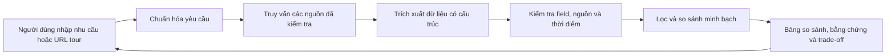

# Tour Decision Support

Hệ thống hỗ trợ người Việt so sánh tour và nhà cung cấp dựa trên dữ liệu có nguồn gốc, độ mới và trade-off rõ ràng. Người dùng tự quyết định; sản phẩm không tự lập lịch trình hay đặt tour.



Backend v1 đã có API, hiểu nhu cầu qua NVIDIA NIM, bộ lọc/so sánh, lưu revision và worker. Hai luồng chạy được với dữ liệu mô phỏng; crawler thật do thành viên phụ trách crawler tích hợp theo contract.

- [Proposal và phân tích bài toán](docs/idea.md)
- [Kiến trúc hệ thống](docs/system-architecture.md)
- [Wireframe](docs/wireframes.md)
- [Kế hoạch backend để thảo luận](docs/backend-plan.md)
- [Contract dữ liệu backend — bản nháp](docs/backend-contracts.md)
- [Module hiểu yêu cầu — bản nháp](src/requirements/README.md)
- [Contract crawler và mẫu JSON — bản nháp](docs/crawler-contract.md)
- [Contract API cho frontend — bản nháp](docs/api-contract.md)
- [Bộ tình huống đánh giá tiếng Việt](docs/requirements-evaluation.md)

## Chạy backend

Python >= 3.12 và uv. Chạy từ thư mục repo:

```powershell
uv sync
uv run tour-backend serve
```

Trang chào backend: `http://127.0.0.1:8000/`; tài liệu tương tác: `http://127.0.0.1:8000/docs`. Sau khi sửa code, dừng server bằng Ctrl+C rồi chạy lại để nạp thay đổi.
NIM đọc `NVIDIA_NIM_API` và `NVIDIA_NIM_MODEL` từ `.env` hiện có. Ngân sách chưa nói phạm vi mặc định là **giá tour**, có provenance `system_default`; currency/basis chưa rõ vẫn được hỏi lại.

- [Hướng dẫn frontend, payload và cấu hình](examples/README.md)
- [Runtime, lệnh kiểm tra và giới hạn](docs/backend-runtime.md)
- [JSON Schema đã xuất cho team](contracts/README.md)

Mặc định `DATA_PROVIDER=fixture`: ba tour giả lập tại `tour-demo.invalid`; mọi kết quả có `origin=synthetic`. Không có dữ liệu tour thật trong repo. Local runtime dùng SQLite và một worker; không chạy nhiều process trên cùng database.

```powershell
uv run pytest -q
uv run ruff check src tests
uv run tour-backend export-schemas
```

Gọi NIM thật (tách khỏi tests offline): `uv run tour-backend probe-nim`; bộ smoke tiếng Việt: `uv run tour-backend evaluate-nim`. Kết quả smoke không thay bộ gold 50 câu + 15 chuỗi hội thoại đầy đủ.
