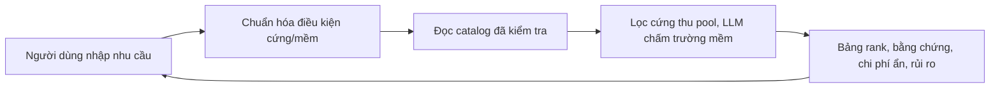

# Tour Decision Support

Hệ thống hỗ trợ người Việt so sánh tour và nhà cung cấp dựa trên dữ liệu có nguồn gốc, độ mới và trade-off rõ ràng. Người dùng tự quyết định; sản phẩm không tự lập lịch trình hay đặt tour.



Tầng ingest đã implement (`src/ingest` + Supabase tour); backend 4 module đã implement (`src/backend`: data/input/normalize/decide + `api` mỏng). Crawler xuất bản catalog, backend chỉ đọc.

- [Proposal và phân tích bài toán](docs/idea.md)
- [Kiến trúc hệ thống](docs/system-architecture.md)
- [Hợp đồng dữ liệu](docs/data-contract.md)
- [Hợp đồng backend](docs/backend-contract.md)
- [Phạm vi MVP](docs/tour-mvp-scope.md)
- [Phân công và quy ước Git](docs/team-workflow.md)

## Chạy tối thiểu backend

```powershell
uv sync
uv run tour-backend serve
```

Trang chào: <http://127.0.0.1:8000/> · API tương tác: <http://127.0.0.1:8000/docs>

Mặc định `DATA_PROVIDER=fixture`, không cần credentials. Catalog thật: `DATA_PROVIDER=supabase` + `SUPABASE_TOUR_DB_URL` (chỉ đọc). LLM thật: `NVIDIA_NIM_API`. Chi tiết: [backend-contract](docs/backend-contract.md), [module backend](src/backend/README.md).

## Chạy tối thiểu module ingest

```powershell
uv run python -m ingest.run --source <source>
```

Bỏ `--source` nghĩa là chạy tất cả (`configs/sources-mvp.csv` / `configs/profiles/`). Audit (`uv run python -m ingest.audit --profile <source>`) chỉ chạy tay khi đổi profile hoặc thêm nguồn mới. Chi tiết: `src/ingest/README.md`.

## Kiểm tra

```powershell
uv run pytest -q
uv run ruff check src tests
```
