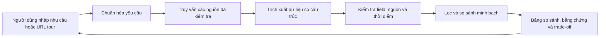

# Tour Decision Support

Hệ thống hỗ trợ người Việt so sánh tour và nhà cung cấp dựa trên dữ liệu có nguồn gốc, độ mới và trade-off rõ ràng. Người dùng tự quyết định; sản phẩm không tự lập lịch trình hay đặt tour.

Idea, kiến trúc và bố cục wireframe đã chốt. Repo hiện có tài liệu và skill thiết kế; các module sản phẩm chưa được implement.

- [Proposal và phân tích bài toán](docs/idea.md)
- [Kiến trúc hệ thống](docs/system-architecture.md)
- [Wireframe](docs/wireframes.md)
- [Planning frontend / UI/UX](docs/frontend-plan.md)
- [Chuẩn bị frontend / UI/UX và skill thiết kế](docs/frontend-design-preparation.md)
- [Hợp đồng dữ liệu và API](docs/data-contract.md)

## Công việc frontend tiếp theo

Review [flow](docs/frontend-flows.md) và [checklist FE–BE](docs/frontend-backend-checklist.md), sau đó chốt nền tảng kỹ thuật và thiết kế UI chi tiết theo planning. Quy trình làm việc ở [AGENTS.md](AGENTS.md).
