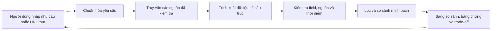

# Tour Decision Support

Hệ thống hỗ trợ người Việt so sánh tour và nhà cung cấp dựa trên dữ liệu có nguồn gốc, độ mới và trade-off rõ ràng. Người dùng tự quyết định; sản phẩm không tự lập lịch trình hay đặt tour.

Đây là kiến trúc mục tiêu. Checkout hiện tại chỉ có tài liệu và cấu hình Python, chưa có code crawler hoặc backend.

- [Proposal và phân tích bài toán](docs/idea.md)
- [Kiến trúc hệ thống](docs/system-architecture.md)
- [Wireframe](docs/wireframes.md)
- [Kế hoạch backend để thảo luận](docs/backend-plan.md)
- [Contract dữ liệu backend — bản nháp](docs/backend-contracts.md)
- [Module hiểu yêu cầu — bản nháp](src/requirements/README.md)
- [Contract crawler và mẫu JSON — bản nháp](docs/crawler-contract.md)
- [Contract API cho frontend — bản nháp](docs/api-contract.md)
- [Bộ tình huống đánh giá tiếng Việt](docs/requirements-evaluation.md)

## Trạng thái phát triển

`pyproject.toml` dùng Python >= 3.12, chưa khai báo dependencies. API, CLI crawler và test suite chưa có trong checkout này; lệnh chạy sẽ được bổ sung khi có implementation tương ứng.
