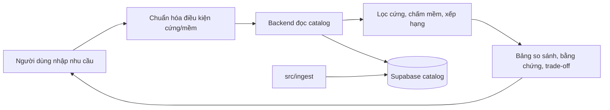

# Tour Decision Support

Hệ thống hỗ trợ người Việt so sánh tour và nhà cung cấp dựa trên dữ liệu có nguồn gốc, độ mới và trade-off rõ ràng. Người dùng tự quyết định; sản phẩm không tự lập lịch trình hay đặt tour.



- [Kiến trúc hệ thống](docs/system-architecture.md)
- [Hợp đồng dữ liệu](docs/data-contract.md) · [Hợp đồng backend](docs/backend-contract.md)
- [Phạm vi MVP](docs/tour-mvp-scope.md) · [Quy ước làm việc](docs/team-workflow.md)
- [Module backend](src/backend/README.md) · [Module frontend](src/frontend/README.md) · [Module ingest](src/ingest/README.md)

## Chạy backend

```powershell
uv sync
uv run tour-backend serve
```

API: <http://127.0.0.1:8000/docs>. Mặc định `DATA_PROVIDER=fixture`; catalog thật dùng `DATA_PROVIDER=supabase` và `SUPABASE_TOUR_DB_URL` (chỉ đọc). LLM dùng `NVIDIA_NIM_API`.

## Frontend

React UI của `main` nằm tại `src/frontend`; package đã cài/build được. Contract phía UI hiện vẫn chứa các call `/v2` và chưa chạy end-to-end với backend chuẩn. Xem [tình trạng tích hợp](src/frontend/BACKEND-GAPS.md); phần chuyển client/flow phải tiếp tục trên `src/backend`, không khôi phục `src/api` cũ.

## Kiểm tra

```powershell
uv run pytest -q
uv run ruff check src tests
pnpm.cmd --dir src/frontend typecheck
pnpm.cmd --dir src/frontend test
pnpm.cmd --dir src/frontend build
```
