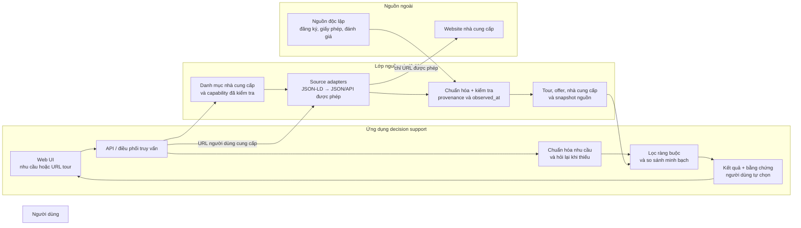
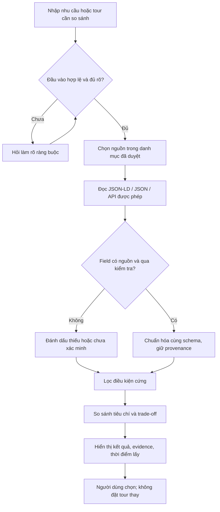

# Kiến trúc hệ thống

**Trạng thái:** Backend v1 đã triển khai theo [backend-plan.md](backend-plan.md). Crawler thật và frontend do thành viên khác phụ trách; backend có fixture và HTTP gateway. Cách chạy/giới hạn ở [backend-runtime.md](backend-runtime.md).

## Sơ đồ tổng quan

## Luồng truy vấn

## Trách nhiệm các phần

| Phần | Trách nhiệm |
|---|---|
| Web UI | Nhận nhu cầu/URL; hiển thị bảng so sánh, dữ liệu thiếu và evidence. |
| API / điều phối | Chọn luồng truy vấn, nguồn đủ điều kiện và điều phối các bước xử lý. |
| Danh mục nhà cung cấp | Lưu domain, URL khởi đầu, capability dữ liệu, trạng thái crawlability và giới hạn truy cập. Danh mục được kiểm tra/cập nhật có chủ đích, không dò toàn bộ Internet. |
| Source adapters | Ưu tiên JSON-LD/JSON/API được phép; chỉ bổ sung adapter theo nguồn khi định dạng khác nhau. Không lấy matching toàn trang làm dữ kiện quyết định. |
| Chuẩn hóa và kiểm tra | Ánh xạ field vào schema chung, giữ giá trị gốc, nguồn, phương pháp, trạng thái xác minh và thời điểm quan sát; từ chối field không đạt kiểm tra. |
| Kho dữ liệu | Lưu hồ sơ nhà cung cấp, hồ sơ tour ổn định và snapshot offer biến động riêng biệt. |
| Bộ so sánh | Áp dụng ràng buộc cứng trước; so sánh tiêu chí công khai, giải thích trade-off; không tạo xếp hạng bí mật. |
| Nguồn độc lập | Bổ sung bằng chứng kiểm tra nhà cung cấp; không coi tự khai báo trên trang bán tour là xác minh độc lập. |

## Quy tắc dữ liệu và thời gian

- Hồ sơ/capability nhà cung cấp có thể được khảo sát và làm mới trước.
- Tour và offer chỉ lấy theo nhu cầu hoặc URL đang so sánh; không crawl trước toàn bộ tour.
- Giá, ngày khởi hành, tình trạng chỗ và phụ thu luôn gắn `observed_at`. Có thể dùng cache khi triển khai, nhưng phải hiển thị thời điểm và cảnh báo dữ liệu cũ; chưa chốt TTL.
- Nếu nguồn bị robots/điều khoản chặn hoặc không trả field sạch, không gọi endpoint đó; trả trạng thái không hỗ trợ/thiếu dữ liệu thay vì suy đoán.
- Mọi kết luận hiển thị phải truy ngược được về field và nguồn chứng minh.

## Giả định và quyết định còn mở

- Phạm vi là web demo; chưa chốt framework UI, API, database hay hosting.
- User chọn cả hai luồng nhập nhu cầu và so sánh URL. Backend dùng FastAPI/Pydantic và durable jobs cho extraction/comparison; endpoints đã có kiểm thử tích hợp với fixture. Contract ở [api-contract.md](api-contract.md) và [crawler-contract.md](crawler-contract.md).
- Danh mục nguồn do team kiểm tra và duyệt. Google Sheets có thể là công cụ vận hành danh mục ở giai đoạn đầu, không phải dependency của luồng quyết định cho người dùng.
- Cách đo độ phù hợp, trọng số tiêu chí, độ tin cậy nguồn và chính sách freshness cần chốt sau khi có bộ dữ liệu mẫu và wireframe được review.
- Phải kiểm tra quyền truy cập và khả năng trích xuất theo từng nguồn trước khi đưa nguồn vào luồng so sánh.
