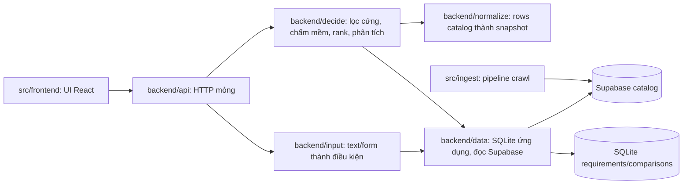

# Kiến trúc hệ thống

Frontend, backend và ingest cùng một project; frontend chỉ gọi HTTP API, backend không import UI. Ingest xuất bản catalog; backend đọc catalog và trả kết quả so sánh. Account/history/jobs/what-if là phần port đã duyệt nhưng chưa runtime-complete.

Luồng: input người dùng → `input` dựng điều kiện cứng/mềm → `decide` lấy ứng viên qua `data`, chuẩn hóa qua `normalize`, lọc cứng thu pool, LLM chấm trường mềm (lịch trình, bao gồm, loại trừ, chính sách trẻ em/hủy), rank rồi báo chi phí ẩn, điều kiện, rủi ro, quyền lợi. Thiếu là `unknown`, không bao giờ tính là đạt.

## Ranh giới runtime

| Phần | Giữ | Không giữ |
|---|---|---|
| `backend/data` | Lưu phiên, đọc catalog chỉ đọc | Rank, LLM, HTTP |
| `backend/input` | Text/form người dùng thành điều kiện | Catalog, so sánh |
| `backend/normalize` | Rows catalog thành snapshot + evidence | Input người dùng, rank |
| `backend/decide` | Lọc cứng, chấm mềm, rank, phân tích | Lưu trữ, HTTP |
| `backend/api` | Routes mỏng, validate, envelope lỗi | Logic nghiệp vụ |
| `frontend` | Form, account, history, results, what-if UI; gọi backend qua HTTP | Truy cập SQLite/Supabase trực tiếp, quyết định eligibility |
| `ingest` | Crawl, làm sạch, xuất bản catalog | Mọi thứ lúc request |

Backend hiện tại là nguồn chuẩn cho API và model. Frontend phải dùng contract hiện tại; không duy trì backend v2 song song. Tour catalog vẫn chỉ đọc.

Đích port history, revisions/proposals và what-if nối vào modules hiện có: `data` lưu record/ownership; `input` dựng requirement revision; `decide` chạy compare/what-if; `normalize` xác thực giá/freshness. Những năng lực chưa có phải được đánh dấu rõ trong contract, không mô tả như runtime đã triển khai.

## Hợp đồng chung

Field/evidence: [data-contract](data-contract.md). API: [backend-contract](backend-contract.md). Crawler xuất bản catalog qua `src/ingest`, backend chỉ đọc. Backend không bao giờ trigger crawl, không fallback fixture khi nguồn live lỗi, không suy giá exact từ giá "from". Frontend được đặt cùng `src/` như module sibling có README riêng; không tạo project/repo layout riêng cho UI.
