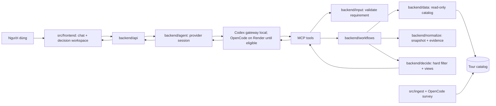

# Kiến trúc hệ thống

Frontend gọi backend qua HTTP. Chat thu thập yêu cầu; agent giữ các lựa chọn còn mở trong một Decision Brief thay vì buộc người dùng chốt một phương án. Preflight catalog dùng điều kiện đã biết để tạo lựa chọn có căn cứ. Sau khi người dùng duyệt Brief, backend lọc theo các nhánh lựa chọn, tạo hồ sơ metric có bằng chứng cho từng tour còn lại, rồi xếp hạng theo các góc nhìn chuẩn và sở thích người dùng. Agent diễn giải yêu cầu; code xác thực evidence và tính metric.

## Workflow

`date_from`/`date_to` là biên bao gồm của khoảng ngày khởi hành được ghi trong catalog, không xác minh ngày về. Một khoảng ngày distinct lưu thành một date assumption dùng chung cho mọi nhánh cùng range.

1. Agent trích hard conditions, soft preferences và các lựa chọn còn mở. `catalog_facets` phân giải nhãn thực; `discover_destinations` kiểm tra điều kiện chung và từng nhánh lựa chọn trên cùng catalog scan. Preflight được chạy một lần cho cùng bộ điều kiện.
2. Brief biểu diễn `conditions` dùng chung theo phép AND và `alternatives` theo phép OR; các điều kiện trong mỗi nhánh vẫn là AND. Các lựa chọn độc lập được group theo `(duration,date_window)`, destination linh hoạt gộp bằng `destination any [...]`. Mốc thời gian mơ hồ được chuẩn hóa thành khoảng ngày có giả định năm/múi giờ hiển thị để người dùng sửa. Người dùng review Brief và trọng số; final comparison chỉ bắt đầu sau khi xác nhận.
3. Backend đọc index nhẹ của toàn phạm vi quét, chuẩn hóa và áp hard filter trước. Offer chỉ qua khi mọi điều kiện chung pass và có ít nhất một nhánh pass đầy đủ; unknown không được xem là pass. Sau đó backend tải itinerary, exclusions, phụ phí và policy chỉ cho hard-pass candidates và nhóm near-miss cần hiển thị. Decision trace vẫn dùng index/evaluations của toàn bộ scan.
4. Metric enrichment đọc riêng itinerary, inclusions, exclusions, surcharges, cancellation và child policy. Structured facts phải có quote khớp nguồn; code chuẩn hóa, tính cost/route/coverage và ghi unknown khi không đủ căn cứ. Kết quả được cache theo content hash và extractor version.
5. Engine tạo metric vector chung cho từng tour: cost, preference fit, experience density, route complexity, inclusion coverage, cancellation flexibility, family suitability và evidence coverage. Từ đó tạo các góc nhìn khả dụng và ít nhất ba tour khác nhau nếu có.
6. Nếu thiếu ba hard-pass tour, API trả số thực có và các kịch bản nới điều kiện có giải thích; không tự sửa brief hoặc tạo tour giả.
7. Comparison, evidence, metric vectors và phương án được lưu cùng snapshot; frontend hiển thị phép tính, giới hạn dữ liệu và hỗ trợ what-if qua brief/trọng số đã review.

Decision trace được dựng từ toàn bộ hard evaluations trước khi rút gọn response. Funnel tuần tự đếm offer và tour riêng; histogram theo từng condition có thể chồng lấp, còn blocker đầu tiên dùng thứ tự condition trong Brief. Runtime snapshot owner-scoped giữ index nhẹ của mọi offer và detail của ứng viên đã tải. Nếu scenario làm một offer trong index lần đầu đạt điều kiện, backend tải detail theo khóa nguồn và chỉ dùng khi timestamp quan sát khớp snapshot; nếu catalog đã đổi, scenario dừng và yêu cầu chạy lại comparison gốc.

Scenario điều kiện chạy lại hard filter trên snapshot gốc; scenario chi phí chỉ tính đơn giá có evidence theo giả định số khách/cơ cấu tuổi/phòng/đêm. Scenario không sửa comparison nguồn. Tour mới qua hard filter cần enrichment theo workflow agent trước khi có metric mềm; nếu chưa có evidence thì metric giữ `unknown`. Điều kiện scenario chỉ được đưa vào Brief dưới dạng bản nháp để người dùng review và xác nhận.

## Frontend presentation and restoration

- `/` là route chính cho hội thoại và quyết định. `/tours` chỉ là URL tương thích, chuyển về `/` và giữ `session`.
- Phiên đang hoạt động có chat/progress và Decision Workspace song song trên desktop; mobile dùng hai tab và composer luôn khả dụng. Đây là cách trình bày cùng pipeline, không tạo API quyết định thứ hai.
- Workspace chia bước: Yêu cầu → Kết quả → Phương án → Kịch bản → Minh bạch. Bước chỉ xuất hiện khi có dữ liệu; panel được giữ mounted khi ẩn để không mất trạng thái kịch bản; comparison mới tự mở bước Kết quả.
- Bước Kết quả mở đầu bằng thẻ Kết luận: tour khuyên theo góc nhìn đang chọn, một câu lý do ngắn và ba dòng trạng thái (điều kiện bắt buộc, ưu tiên, điểm phải chấp nhận). Mỗi thẻ tour có hai cột Được / Mất so với tour dẫn đầu (chênh giá, chặng, mốc hủy, khoản chưa định giá) và giữ quote nguồn.
- Local transcript lưu artifact `decision_draft` và `comparison`. Workspace dựng trạng thái từ chúng, không parse nội dung assistant; session cũ chỉ có `requirementId`/`comparisonId` được hydrate qua endpoint hiện tại.
- Kết quả chỉ hiện hành khi requirement của comparison khớp Brief đã review. Nếu Brief thay đổi, comparison cũ vẫn được giữ và gắn trạng thái cũ.
- Cả hai pane dùng design tokens, typography, surfaces và state colors hiện có; không tạo palette/font riêng.

## Ranh giới module

| Module | Trách nhiệm | Không làm |
|---|---|---|
| `backend/agent` | Hội thoại, draft requirement, gọi MCP, semantic evaluation có evidence | Quyết định hard eligibility, tự tính điểm hoặc truy cập UI |
| `backend/input` | Validate cấu trúc requirement, `weight_percent`, giá trị tiền/ngày | Parse business decision từ free text |
| `backend/data` | Đọc catalog; lưu owner-scoped session/records, decision handoff và cache metric theo hash nội dung/phiên bản | Rank hoặc gọi LLM |
| `backend/normalize` | Chuyển row thành snapshot/evidence, giữ price basis và price by age ở cấp offer | Alias địa danh hoặc quyết định |
| `backend/decide` | Hard filter, kiểm tra structured evidence, metric vector, weighted fit, objective views/Pareto, near-miss | LLM, HTTP, storage |
| `backend/workflows` | Ghép input/catalog/normalize/decide, quản lý scan context và batch | UI hoặc giao thức HTTP |
| `backend/api` | Auth owner, route, SSE/JSON envelope | Logic ra quyết định |
| `frontend` | Draft review, mức ưu tiên, decision workspace theo bước, saved tours | Truy cập database hoặc tự suy eligibility |
| `ingest` | Xuất bản catalog, giữ giá/basis/tuổi/phụ thu ở cấp offer | Chạy trong request demo |

## Quy tắc kỹ thuật

- Database catalog là nguồn có thẩm quyền. Hard filter luôn chạy trước soft ranking.
- Soft evaluation bao phủ mọi ứng viên hard-pass trong scan, không chỉ các tour có thể lọt top N theo ranking cũ. Batching giới hạn context model; scan limit vẫn giới hạn số record được đọc.
- Price vectors dùng mọi giá công bố dạng số trong cùng currency để lọc ngân sách và xếp giá; giá công bố, tổng đã tính, khoản đã định giá và exclusions chưa định giá vẫn hiển thị tách biệt. Không gọi giá công bố là tổng tiền cuối cùng.
- Exclusion không tự động là khoản phát sinh. Phân loại bắt buộc/tùy chọn/có điều kiện; chỉ tính khoản có amount, unit và điều kiện áp dụng được xác nhận.
- Metric dùng đơn vị/scale riêng và evidence. Không ép thành một điểm tổng; unknown tạo khoảng hoặc trạng thái chưa so sánh được.
- Objective views tối ưu metric cụ thể hoặc người dùng; Pareto chỉ so trên dimensions có thứ tự/đơn vị hợp lệ và không bị thiếu evidence làm giả thứ hạng.
- Metric cache được khóa bằng hash nội dung nguồn và phiên bản extractor; freshness và độ phủ hiển thị riêng, không gọi là xác suất tin cậy.
- Ngày trong offer được so trực tiếp với khoảng ngày người dùng yêu cầu, không bị chặn bởi tuổi crawl; `observed_at` chỉ là nguồn gốc thời điểm ghi nhận. Demo dùng catalog hiện có làm snapshot dữ liệu mới nhất, không diễn đạt kết quả ngày là xác nhận tồn chỗ trực tiếp.
- Điểm đến không được gắn nhãn “gần” nếu catalog không có dữ liệu địa lý để chứng minh. Khi thiếu nơi khởi hành, không tự thêm hard condition.
- Kết quả có tối thiểu ba tour khác nhau nếu scan có đủ tour qua hard filter; thiếu thì báo số thực có và kịch bản nới điều kiện chờ duyệt. Nhiều góc nhìn không tự bảo đảm có ba phương án khác nhau.
- Không đặt deadline tổng cho agent. Giữ timeout riêng cho MCP/data calls và hủy process khi client disconnect.
- Kết quả quyết định đi từ MCP tới API qua runtime store bằng `decision_run_id`; không phụ thuộc provider có lặp lại JSON của tool trong output model hay không. Codex thread ID và OpenCode session ID được lưu riêng trong cùng owner-scoped agent record.
- Local chat dùng Codex CLI (`gpt-6-luna`, medium) qua gateway riêng, nạp prompt từ `configs/prompts/backend-agent.yaml`, chỉ bật MCP `tour-catalog` và tắt shell/multi-agent. Render tiếp tục OpenCode cho tới khi được xác nhận đủ điều kiện dùng ChatGPT plan trên app remote-hosted.
- Render free không giữ filesystem qua spin-down/redeploy; Codex cần device-code login lại. Khi resume báo thread cũ không còn, backend bỏ ID cũ để lần retry mở thread mới. Requirement/comparison lưu ở Supabase không bị ảnh hưởng.
- Thêm field model có default để dữ liệu comparison cũ vẫn đọc được. Thay đổi schema catalog offer cần migration; metric cache dùng schema runtime có phiên bản.

Contract chi tiết: [backend-contract](backend-contract.md). Field/evidence: [data-contract](data-contract.md).
