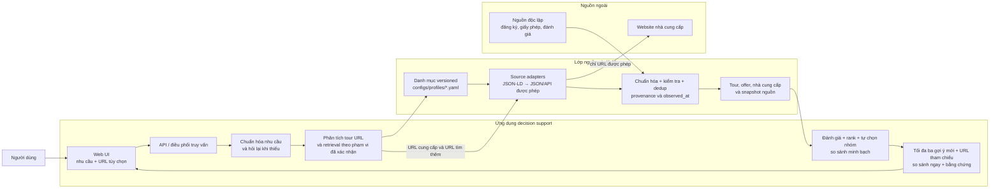
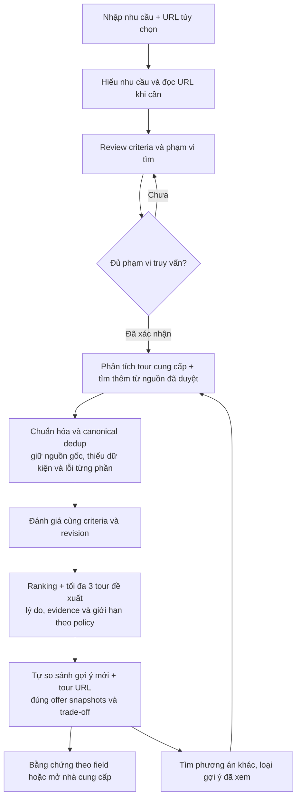

# Kiến trúc hệ thống

**Trạng thái:** Kiến trúc mục tiêu/flow kết hợp cập nhật ngày 03/10/2026. Sơ đồ mô tả URL + retrieval chung (G9), ranking/Top 3 có giải thích (G10); v1 hiện tách mode/chưa ranking. V1 FastAPI/Pydantic, SQLite/worker theo [backend-plan.md](backend-plan.md), fixture/gateway theo [backend-runtime.md](backend-runtime.md). Crawler chưa nối [D1–D5](frontend-crawler-integration.md); FE vẫn PLANNING.

## Thứ tự lát cắt frontend

P4.2 xây nhập/review; P4.3 nhận đề xuất/bảng tự động từ BE, không màn danh sách/chọn tour. G9/G10: retrieval/đánh giá/rank/tự chọn tối đa ba gợi ý mới → so cùng URL tham chiếu → vòng phương án khác hoặc sửa nhu cầu. Budget khởi điểm 20 ứng viên và URL ngoài số ba là đề xuất cần review/đo; v1 chưa hỗ trợ, không dùng CSV/crawler thô làm DTO.

## Sơ đồ tổng quan

## Luồng truy vấn

## Trách nhiệm các phần

| Phần | Trách nhiệm |
|---|---|
| Web UI | Input/review → render nhóm đề xuất/bảng tự động, URL tham chiếu/evidence; cho tìm phương án khác/sửa yêu cầu. Không tự rank/ghép hai response v1 hoặc bắt chọn tour. |
| API / điều phối | URL + retrieval theo phạm vi; dedup/nguồn gốc/lỗi/criteria/revision/snapshots. BE điều phối budget/pool và vòng phương án khác/exclusion/reuse; đề xuất 20 cần đo, G9/G10 chưa implement. |
| Danh mục nhà cung cấp | `configs/profiles/<nguồn>.yaml` là nguồn chuẩn trong Git: origin, sitemaps, pattern URL tour, alias field và pattern lọc. Kết quả khảo sát nguồn (quyền crawl, field có/thiếu, giới hạn, ngày kiểm tra) ghi theo [provider registry](provider-registry.md). Danh mục được cập nhật có chủ đích, không dò toàn bộ Internet. |
| Source adapters | Ưu tiên JSON-LD/JSON/API được phép; chỉ bổ sung adapter theo nguồn khi định dạng khác nhau. Không lấy matching toàn trang làm dữ kiện quyết định. |
| Chuẩn hóa và kiểm tra | Ánh xạ field vào schema chung, giữ giá trị gốc, nguồn, phương pháp, trạng thái xác minh và thời điểm quan sát; từ chối field không đạt kiểm tra. |
| Kho dữ liệu | Lưu hồ sơ nhà cung cấp, hồ sơ tour ổn định và snapshot offer biến động riêng biệt. |
| Bộ so sánh | Hard gating/đánh giá → ranking/Top 3 có lý do và policy minh bạch (G10 chưa implement) → tự so sánh gợi ý + tham chiếu/trade-off. Không coi unknown là pass hay tạo xếp hạng bí mật. |
| Nguồn độc lập | Bổ sung bằng chứng kiểm tra nhà cung cấp; không coi tự khai báo trên trang bán tour là xác minh độc lập. |

## Quy tắc dữ liệu và thời gian

- Hồ sơ/capability nhà cung cấp có thể được khảo sát và làm mới trước.
- Tour và offer lấy theo nhu cầu đã xác nhận và URL cung cấp; URL không giới hạn hệ thống chỉ đọc những tour đó. Khi thiếu nhu cầu, dữ kiện URL chỉ gợi ý phạm vi truy vấn, không tự thành hard constraints. Không crawl trước toàn bộ tour.
- Giá, ngày khởi hành, tình trạng chỗ và phụ thu luôn gắn `observed_at`. Có thể dùng cache khi triển khai, nhưng phải hiển thị thời điểm và cảnh báo dữ liệu cũ; chưa chốt TTL.
- Nếu nguồn bị robots/điều khoản chặn hoặc không trả field sạch, không gọi endpoint đó; trả trạng thái không hỗ trợ/thiếu dữ liệu thay vì suy đoán.
- Mọi kết luận hiển thị phải truy ngược được về field và nguồn chứng minh.

## Giả định và quyết định còn mở

- Phạm vi là web demo; frontend framework và hosting chưa chốt. Backend local đã dùng FastAPI/Pydantic, SQLite và durable jobs.
- User yêu cầu bỏ sàng lọc/chọn tour thủ công: hệ thống tự tìm/rank/đề xuất/so sánh, có phương án khác/sửa yêu cầu. Giữ G1–G10/D1–D5; budget 20 và count URL là giả định cần review, không mô tả runtime hiện có.
- Danh mục nguồn được team quản lý trong Git (`configs/profiles/*.yaml` và [provider registry](provider-registry.md)); capability runtime BE là contract riêng cần đối chiếu, không dùng Google Sheets song song.
- Cách đo độ phù hợp, trọng số tiêu chí, độ tin cậy nguồn và chính sách freshness cần chốt sau khi có bộ dữ liệu mẫu và wireframe được review.
- Phải kiểm tra quyền truy cập và khả năng trích xuất theo từng nguồn trước khi đưa nguồn vào luồng so sánh.
