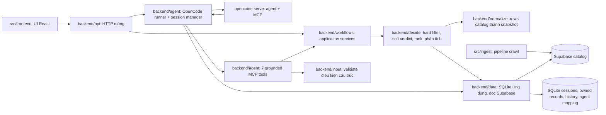

# Kiến trúc hệ thống

Frontend, backend và ingest cùng một project; frontend chỉ gọi HTTP API, backend không import UI. Ingest xuất bản catalog; backend đọc catalog và trả kết quả so sánh. Guest session/basic history chạy trên runtime hiện tại. Chat dùng một OpenCode conversation cho mỗi local chat; agent quyết định khi nào gọi MCP, còn backend tools xác thực dữ liệu, áp hard rules, xác minh evidence và lưu kết quả. Account/Auth, proposals/jobs/what-if vẫn chưa runtime-complete.

Luồng: input tự do → OpenCode agent hỏi thêm hoặc gọi MCP → tool kiểm tra điều kiện có cấu trúc → `decide` lấy ứng viên qua `data`, chuẩn hóa qua `normalize`, hard-filter trả pass/unknown/fail → agent chấm soft thành fit/unknown/not_fit với quote → rank theo số fit rồi giá → trả tối đa 5 tour. Thiếu là unknown, không bao giờ tính là đạt.

## Ranh giới runtime

| Phần | Giữ | Không giữ |
|---|---|---|
| `backend/data` | Guest sessions, owner-scoped records/history, đọc catalog chỉ đọc | Rank, LLM, HTTP |
| `backend/input` | Validate điều kiện có cấu trúc, tiền VND integer, ngày ISO | Text extraction, catalog, so sánh |
| `backend/normalize` | Rows catalog thành snapshot + evidence | Input người dùng, rank |
| `backend/decide` | Lọc cứng, áp soft verdict có evidence, rank, phân tích | Lưu trữ, HTTP, gọi LLM |
| `backend/workflows` | Ghép input/catalog/decide thành use case dùng chung | HTTP, UI |
| `backend/agent` | Gọi OpenCode CLI qua server đã cấu hình, giữ owner-scoped session, validate tool results | Quyết định hard eligibility ngoài tools, truy cập UI |
| `backend/api` | Routes mỏng, validate, envelope lỗi | Logic nghiệp vụ |
| `frontend` | Guest search/session/results; gọi backend qua HTTP | Truy cập SQLite/Supabase trực tiếp, quyết định eligibility |
| `ingest` | Crawl, làm sạch, xuất bản catalog | Mọi thứ lúc request |

Backend hiện tại là nguồn chuẩn cho API và model. Frontend phải dùng contract hiện tại; không duy trì backend v2 song song. Tour catalog vẫn chỉ đọc. Chat cần OpenCode server và không rơi về keyword/NIM extraction khi thiếu. MCP `query_tours`, `score_soft` và `relax_criterion` gọi cùng pipeline `input`/`decide`; backend lưu kết quả tool đã validate. Agent endpoint mặc định trả JSON, đồng thời hỗ trợ SSE để đẩy trạng thái tool lên giao diện theo thời gian thực.

Đích port account history, revisions/proposals và what-if nối vào modules hiện có: `data` lưu record/ownership; `input` dựng requirement revision; `decide` chạy compare/what-if; `normalize` xác thực giá/freshness. Guest history hiện chỉ có list/detail/pagination. Những năng lực chưa có phải được đánh dấu rõ trong contract, không mô tả như runtime đã triển khai.

## Hợp đồng chung

Field/evidence: [data-contract](data-contract.md). API: [backend-contract](backend-contract.md). Crawler xuất bản catalog qua `src/ingest`, backend chỉ đọc. Backend không bao giờ trigger crawl, không fallback fixture khi nguồn live lỗi, không suy giá exact từ giá "from". Frontend được đặt cùng `src/` như module sibling có README riêng; không tạo project/repo layout riêng cho UI.
