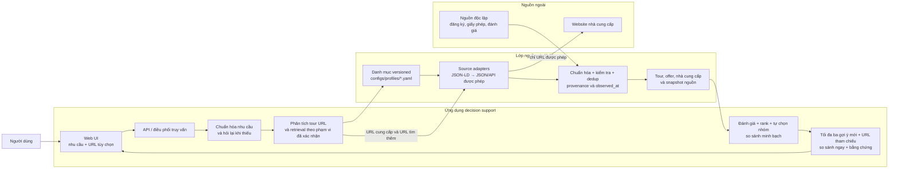
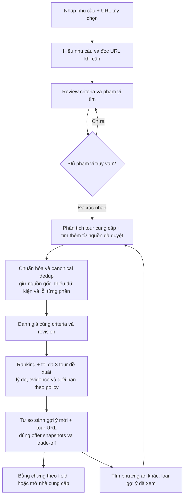

# Kiến trúc hệ thống

**Trạng thái:** Đã merge crawler + backend (08/10/2026). Tầng ingest đã implement (`src/ingest`, 3 profile audit, Supabase 1210 tour) và backend v1/v2 đã implement (FastAPI/Pydantic, requirements/NIM, compare, đọc Supabase catalog); UI prototype đang review. Tích hợp crawler→backend qua Supabase reader/adapter vẫn đang hoàn thiện.

## Thứ tự lát cắt frontend

MVP đầu tiên nhận 2–3 URL tour để so sánh, đồng thời hỗ trợ luồng tự tìm/rank/đề xuất tối đa 3 gợi ý mới (P4.2/P4.3, G9/G10). Backend và frontend tích hợp bằng fixture `Tour`/`Offer` chuẩn hóa trước; tìm tour theo mô tả nhu cầu và truy vấn nguồn thật phát triển tiếp sau. Hợp đồng field/evidence và request/response nằm ở [data contract](data-contract.md). Tầng ingest vừa audit khả năng trích xuất (selftest/audit) vừa là kho dữ liệu tour runtime (snapshot → Supabase).

## Sơ đồ tổng quan

## Luồng truy vấn

## Trách nhiệm các phần

| Phần | Trách nhiệm |
|---|---|
| Web UI | Nhận nhu cầu/URL; hiển thị bảng so sánh, dữ liệu thiếu và evidence. Input/review → render nhóm đề xuất/bảng tự động, URL tham chiếu/evidence; cho tìm phương án khác/sửa yêu cầu. |
| API / điều phối | Chọn luồng truy vấn, nguồn đủ điều kiện và điều phối các bước xử lý. URL + retrieval theo phạm vi; dedup/nguồn gốc/lỗi/criteria/revision/snapshots; điều phối budget/pool và vòng phương án khác. |
| Danh mục nhà cung cấp | `configs/profiles/<nguồn>.yaml` là nguồn chuẩn trong Git: origin, sitemaps, pattern URL tour, khối discovery, field DSL. Kết quả khảo sát nguồn (quyền crawl, field có/thiếu, giới hạn, ngày kiểm tra) nằm ở `artifacts/agent_surveys/<nguồn>/` và tóm tắt ở [provider registry](provider-registry.md). Danh mục được cập nhật có chủ đích, không dò toàn bộ Internet. |
| Source adapters | Ưu tiên JSON-LD/JSON/API được phép; chỉ bổ sung adapter theo nguồn khi định dạng khác nhau. Không lấy matching toàn trang làm dữ kiện quyết định. |
| Chuẩn hóa và kiểm tra | Ánh xạ field vào schema chung, giữ giá trị gốc, nguồn, phương pháp, trạng thái xác minh và thời điểm quan sát; từ chối field không đạt kiểm tra. |
| Kho dữ liệu | Lưu hồ sơ nhà cung cấp, hồ sơ tour ổn định và snapshot offer biến động riêng biệt. |
| Bộ so sánh | Hard gating/đánh giá → ranking/Top 3 có lý do và policy minh bạch (G10 chưa implement) → tự so sánh gợi ý + tham chiếu/trade-off. Không coi unknown là pass hay tạo xếp hạng bí mật. |
| Nguồn độc lập | Bổ sung bằng chứng kiểm tra nhà cung cấp; không coi tự khai báo trên trang bán tour là xác minh độc lập. |

## Quy tắc dữ liệu và thời gian

- Hồ sơ/capability nhà cung cấp có thể được khảo sát và làm mới trước.
- Tour và offer lấy theo nhu cầu/URL đang so sánh hoặc theo đợt discovery định kỳ (search_pages/sitemap → batch → Supabase); không dò toàn bộ Internet ngoài danh mục nguồn. URL ngoài phạm vi hệ thống chỉ đọc những tour đó; khi thiếu nhu cầu, dữ kiện URL chỉ gợi ý phạm vi truy vấn, không tự thành hard constraints.
- Trong MVP, bộ so sánh dùng fixture chuẩn hóa theo data contract; adapter/crawl runtime có thể thay fixture sau mà không đổi giao diện frontend.
- Giá, ngày khởi hành, tình trạng chỗ và phụ thu luôn gắn `observed_at`. Có thể dùng cache khi triển khai, nhưng phải hiển thị thời điểm và cảnh báo dữ liệu cũ; chưa chốt TTL.
- Nếu nguồn bị robots/điều khoản chặn hoặc không trả field sạch, không gọi endpoint đó; trả trạng thái không hỗ trợ/thiếu dữ liệu thay vì suy đoán.
- Mọi kết luận hiển thị phải truy ngược được về field và nguồn chứng minh.

## Giả định và quyết định còn mở

- Phạm vi là web demo; contract API dùng JSON. Backend local dùng FastAPI/Pydantic, SQLite và durable jobs; frontend framework và hosting chưa chốt.
- User yêu cầu bỏ sàng lọc/chọn tour thủ công: hệ thống tự tìm/rank/đề xuất/so sánh, có phương án khác/sửa yêu cầu.
- Danh mục nguồn hiện được team quản lý trong Git (`configs/profiles/*.yaml`, kết quả khảo sát ở `artifacts/agent_surveys/<nguồn>/`, tóm tắt ở [provider registry](provider-registry.md)); capability runtime của backend là contract riêng cần đối chiếu. Không có bản Google Sheets song song. Nếu sau này cần giao diện cho người không quen Git, phải chuyển nguồn chuẩn thay vì duy trì hai bản.
- Cách đo độ phù hợp, trọng số tiêu chí, độ tin cậy nguồn và chính sách freshness cần chốt sau khi có bộ dữ liệu mẫu và wireframe được review.
- Phải kiểm tra quyền truy cập và khả năng trích xuất theo từng nguồn trước khi đưa nguồn vào luồng so sánh.
