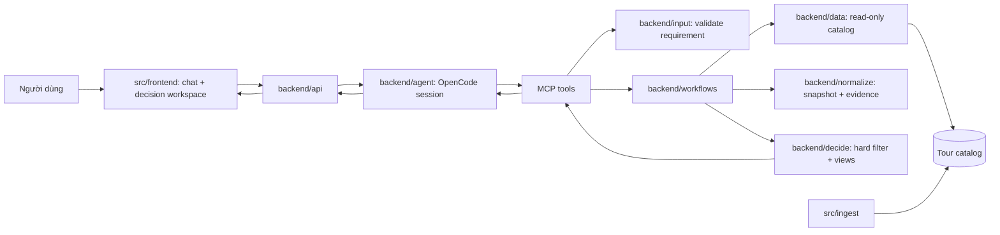

# Kiến trúc hệ thống

Frontend gọi backend qua HTTP. Chat thu thập và làm rõ yêu cầu; trước khi gợi ý địa điểm, agent chạy preflight catalog theo hard condition đã biết. Sau khi người dùng duyệt Decision Brief, backend lọc ứng viên, tạo hồ sơ metric có bằng chứng cho từng tour còn lại, rồi xếp hạng theo các góc nhìn chuẩn và sở thích người dùng. Agent diễn giải yêu cầu; code xác thực evidence và tính metric.

## Workflow

1. Agent trích hard conditions và soft preferences; `catalog_facets` phân giải nhãn thực, `discover_destinations` kiểm tra tính khả thi trước khi đề xuất.
2. Người dùng review brief và trọng số. Final comparison chỉ bắt đầu sau khi xác nhận.
3. Backend quét catalog, chuẩn hóa snapshot và áp hard filter trên toàn bộ scan. Offer chỉ qua khi mọi hard condition pass; unknown không được xem là pass.
4. Metric enrichment đọc riêng itinerary, inclusions, exclusions, surcharges, cancellation và child policy. Structured facts phải có quote khớp nguồn; code chuẩn hóa, tính cost/route/coverage và ghi unknown khi không đủ căn cứ. Kết quả được cache theo content hash và extractor version.
5. Engine tạo metric vector chung cho từng tour: cost, preference fit, experience density, route complexity, inclusion coverage, cancellation flexibility, family suitability và evidence coverage. Từ đó tạo các góc nhìn khả dụng và ít nhất ba tour khác nhau nếu có.
6. Nếu thiếu ba hard-pass tour, API trả số thực có và các kịch bản nới điều kiện có giải thích; không tự sửa brief hoặc tạo tour giả.
7. Comparison, evidence, metric vectors và phương án được lưu cùng snapshot; frontend hiển thị phép tính, giới hạn dữ liệu và hỗ trợ what-if qua brief/trọng số đã review.

## Frontend presentation and restoration

- `/` là route chính cho hội thoại và quyết định. `/tours` chỉ là URL tương thích, chuyển về `/` và giữ `session`.
- Phiên đang hoạt động có chat/progress và Decision Workspace song song trên desktop; mobile dùng hai tab và composer luôn khả dụng. Đây là cách trình bày cùng pipeline, không tạo API quyết định thứ hai.
- Local transcript lưu artifact `decision_draft` và `comparison`. Workspace dựng trạng thái từ chúng, không parse nội dung assistant; session cũ chỉ có `requirementId`/`comparisonId` được hydrate qua endpoint hiện tại.
- Kết quả chỉ hiện hành khi requirement của comparison khớp Brief đã review. Nếu Brief thay đổi, comparison cũ vẫn được giữ và gắn trạng thái cũ.
- Cả hai pane dùng design tokens, typography, surfaces và state colors hiện có; không tạo palette/font riêng.

## Ranh giới module

| Module | Trách nhiệm | Không làm |
|---|---|---|
| `backend/agent` | Hội thoại, draft requirement, gọi MCP, semantic evaluation có evidence | Quyết định hard eligibility, tự tính điểm hoặc truy cập UI |
| `backend/input` | Validate cấu trúc requirement, `weight_percent`, giá trị tiền/ngày | Parse business decision từ free text |
| `backend/data` | Đọc catalog; lưu owner-scoped session/records, decision handoff và cache metric theo hash nội dung/phiên bản | Rank hoặc gọi LLM |
| `backend/normalize` | Chuyển row thành snapshot/evidence, giữ price basis và price by age ở cấp offer | Alias địa danh hoặc quyết định |
| `backend/decide` | Hard filter, kiểm tra structured evidence, metric vector, weighted fit, objective views/Pareto, near-miss | LLM, HTTP, storage |
| `backend/workflows` | Ghép input/catalog/normalize/decide, quản lý scan context và batch | UI hoặc giao thức HTTP |
| `backend/api` | Auth owner, route, SSE/JSON envelope | Logic ra quyết định |
| `frontend` | Draft review, trọng số, decision workspace, saved tours | Truy cập database hoặc tự suy eligibility |
| `ingest` | Xuất bản catalog, giữ giá/basis/tuổi/phụ thu ở cấp offer | Chạy trong request demo |

## Quy tắc kỹ thuật

- Database catalog là nguồn có thẩm quyền. Hard filter luôn chạy trước soft ranking.
- Soft evaluation bao phủ mọi ứng viên hard-pass trong scan, không chỉ các tour có thể lọt top N theo ranking cũ. Batching giới hạn context model; scan limit vẫn giới hạn số record được đọc.
- Price vectors tách giá exact/from/contact, tổng đã tính, khoản đã định giá và khoản loại trừ chưa định giá; chỉ exact cùng currency được dùng để kết luận rẻ nhất.
- Exclusion không tự động là khoản phát sinh. Phân loại bắt buộc/tùy chọn/có điều kiện; chỉ tính khoản có amount, unit và điều kiện áp dụng được xác nhận.
- Metric dùng đơn vị/scale riêng và evidence. Không ép thành một điểm tổng; unknown tạo khoảng hoặc trạng thái chưa so sánh được.
- Objective views tối ưu metric cụ thể hoặc người dùng; Pareto chỉ so trên dimensions có thứ tự/đơn vị hợp lệ và không bị thiếu evidence làm giả thứ hạng.
- Metric cache được khóa bằng hash nội dung nguồn và phiên bản extractor; freshness và độ phủ hiển thị riêng, không gọi là xác suất tin cậy.
- Ngày trong offer được so trực tiếp với khoảng ngày người dùng yêu cầu, không bị chặn bởi tuổi crawl; `observed_at` chỉ là nguồn gốc thời điểm ghi nhận. Demo dùng catalog hiện có làm snapshot dữ liệu mới nhất, không diễn đạt kết quả ngày là xác nhận tồn chỗ trực tiếp.
- Kết quả có tối thiểu ba tour khác nhau nếu scan có đủ tour qua hard filter; thiếu thì báo số thực có và kịch bản nới điều kiện chờ duyệt. Nhiều góc nhìn không tự bảo đảm có ba phương án khác nhau.
- Không đặt deadline tổng cho agent. Giữ timeout riêng cho MCP/data calls và hủy process khi client disconnect.
- Kết quả quyết định đi từ MCP tới API qua runtime store bằng `decision_run_id`; không phụ thuộc OpenCode có lặp lại JSON của tool trong output model hay không.
- Thêm field model có default để dữ liệu comparison cũ vẫn đọc được. Thay đổi schema catalog offer cần migration; metric cache dùng schema runtime có phiên bản.

Contract chi tiết: [backend-contract](backend-contract.md). Field/evidence: [data-contract](data-contract.md).
