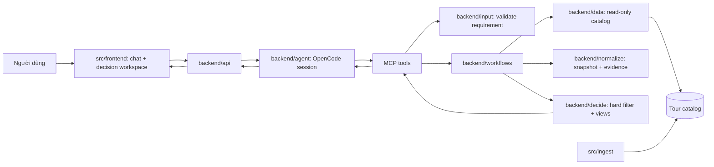

# Kiến trúc hệ thống

Frontend gọi backend qua HTTP. Chat chỉ thu thập và làm rõ yêu cầu; so sánh tour chỉ bắt đầu khi người dùng xác nhận Decision Brief đã review. Agent diễn giải ngôn ngữ và đánh giá evidence; backend kiểm tra schema, áp điều kiện cứng và tính các góc nhìn quyết định.

## Workflow

1. Người dùng gửi mô tả tự do qua chat. Agent có thể hỏi thêm hoặc tạo requirement draft; ở bước này không gọi truy vấn tour.
2. Frontend lưu draft cùng phiên để khôi phục sau reload. Người dùng chỉnh điều kiện và phân bổ 100 điểm giữa các sở thích mềm.
3. Frontend gửi requirement đã review tới `POST /agent/sessions/{id}/decisions`. Backend validate lại và mở lượt agent để chấm evidence.
4. `query_tours` quét catalog đến `data.scan_limit`, chuẩn hóa snapshot, áp hard filter trên toàn bộ ứng viên đã quét và tạo context. Các ứng viên hard-pass được gửi cho agent theo batch để đánh giá từng soft condition.
5. Engine xác thực quote, gắn verdict `pass|fail|unknown`, tính điểm trọng số và trả `decision_views`: giá thấp nhất, hợp ưu tiên nhất và Pareto cân bằng. Kết quả giữ `ranked`/`near_miss` cho consumer hiện tại. MCP ghi Comparison hoàn tất vào runtime store theo `decision_run_id`.
6. Agent service lấy Comparison theo `decision_run_id`, kiểm tra requirement, lưu dưới owner của phiên và stream kết quả. Nội dung model không phải nguồn xác nhận hoàn tất.

## Ranh giới module

| Module | Trách nhiệm | Không làm |
|---|---|---|
| `backend/agent` | Hội thoại, draft requirement, gọi MCP, semantic evaluation có evidence | Quyết định hard eligibility, tự tính điểm hoặc truy cập UI |
| `backend/input` | Validate cấu trúc requirement, `weight_percent`, giá trị tiền/ngày | Parse business decision từ free text |
| `backend/data` | Đọc catalog; lưu owner-scoped session/records và kết quả tạm theo decision run để MCP bàn giao cho API | Rank hoặc gọi LLM |
| `backend/normalize` | Chuyển row thành snapshot/evidence | Alias địa danh hoặc quyết định |
| `backend/decide` | Hard filter, xác thực soft evidence, weighted views, Pareto, near-miss | LLM, HTTP, storage |
| `backend/workflows` | Ghép input/catalog/normalize/decide, quản lý scan context và batch | UI hoặc giao thức HTTP |
| `backend/api` | Auth owner, route, SSE/JSON envelope | Logic ra quyết định |
| `frontend` | Draft review, trọng số, decision workspace, saved tours | Truy cập database hoặc tự suy eligibility |
| `ingest` | Xuất bản catalog | Chạy trong request demo |

## Quy tắc kỹ thuật

- Database catalog là nguồn có thẩm quyền. Hard filter luôn chạy trước soft ranking.
- Soft evaluation bao phủ mọi ứng viên hard-pass trong scan, không chỉ các tour có thể lọt top N theo ranking cũ. Batching giới hạn context model; scan limit vẫn giới hạn số record được đọc.
- Giá rẻ nhất chỉ dùng giá exact cùng currency. Không quy đổi currency và không coi `from` là giá exact.
- Điểm phù hợp là tổng trọng số các verdict `pass`; `unknown` không được đổi thành `fail` và không đóng góp điểm. Evidence quote phải khớp snapshot.
- Pareto giữ các phương án không bị trội đồng thời về exact price và preference score; không tạo điểm tổng hợp bí ẩn.
- Không đặt deadline tổng cho agent. Giữ timeout riêng cho MCP/data calls và hủy process khi client disconnect.
- Kết quả quyết định đi từ MCP tới API qua runtime store bằng `decision_run_id`; không phụ thuộc OpenCode có lặp lại JSON của tool trong output model hay không.
- Thêm field model có default để dữ liệu comparison cũ vẫn đọc được; không cần migration database cho `decision_views`.

Contract chi tiết: [backend-contract](backend-contract.md). Field/evidence: [data-contract](data-contract.md).
