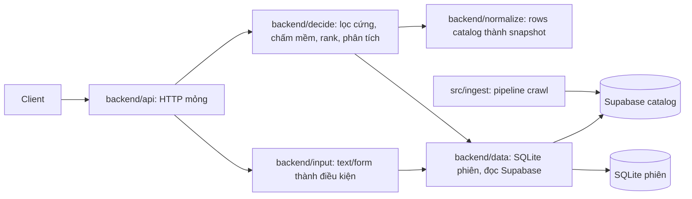

# Kiến trúc hệ thống

Hai runtime độc lập. Crawler xuất bản catalog; backend đọc catalog và trả so sánh. Không bên nào import bên nào.

Luồng: input người dùng → `input` dựng điều kiện cứng/mềm → `decide` lấy ứng viên qua `data`, chuẩn hóa qua `normalize`, lọc cứng thu pool, LLM chấm trường mềm (lịch trình, bao gồm, loại trừ, chính sách trẻ em/hủy), rank rồi báo chi phí ẩn, điều kiện, rủi ro, quyền lợi. Thiếu là `unknown`, không bao giờ tính là đạt.

## Ranh giới runtime

| Phần | Giữ | Không giữ |
|---|---|---|
| `backend/data` | Lưu phiên, đọc catalog chỉ đọc | Rank, LLM, HTTP |
| `backend/input` | Text/form người dùng thành điều kiện | Catalog, so sánh |
| `backend/normalize` | Rows catalog thành snapshot + evidence | Input người dùng, rank |
| `backend/decide` | Lọc cứng, chấm mềm, rank, phân tích | Lưu trữ, HTTP |
| `backend/api` | Routes mỏng, validate, envelope lỗi | Logic nghiệp vụ |
| `ingest` | Crawl, làm sạch, xuất bản catalog | Mọi thứ lúc request |

## Hợp đồng chung

Field/evidence: [data-contract](data-contract.md). API: [backend-contract](backend-contract.md). Crawler xuất bản catalog qua `src/ingest`, backend chỉ đọc. Backend không bao giờ trigger crawl, không fallback fixture khi nguồn live lỗi, không suy giá exact từ giá "from".
